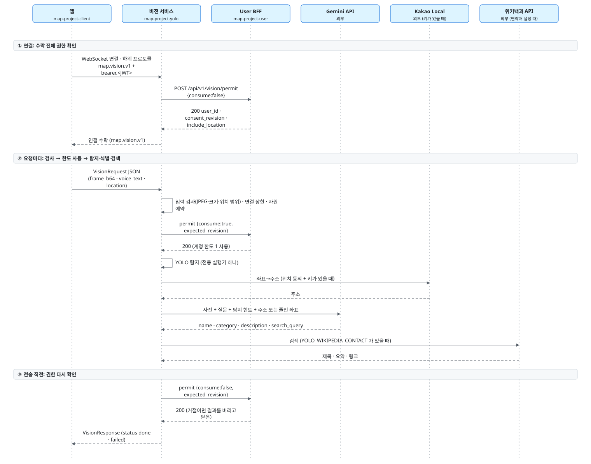

# map-project-yolo

카메라 사진이나 질문을 WebSocket 으로 받아, 사진 속 대상을 YOLO 로 탐지하고 Gemini 로 식별해 돌려주는 MAP 의 비전 서비스.

## 저장소 지도

MAP 는 일곱 저장소로 이루어져 있다. 전체 구조와 한 번에 실행하는 방법은 [map-project-infra](https://github.com/we-meet-trip/map-project-infra) 에서 시작한다.

| 저장소 | 역할 |
|---|---|
| [map-project-infra](https://github.com/we-meet-trip/map-project-infra) | 전체 안내, 로컬 실행 구성(Docker Compose), DB 초기화 |
| [map-project-client](https://github.com/we-meet-trip/map-project-client) | 모바일 앱(Flutter, iOS·Android) |
| [map-project-user](https://github.com/we-meet-trip/map-project-user) | 사용자 BFF(Spring Boot): 인증·일정·채팅·동의, 다른 서비스 중계 |
| [map-project-agent](https://github.com/we-meet-trip/map-project-agent) | 추천 에이전트(FastAPI·LangGraph): 장소·경로·일정 생성 |
| [map-project-hub](https://github.com/we-meet-trip/map-project-hub) | 외부 데이터 게이트웨이(FastAPI·PostGIS): 관광·날씨·장소·경로 |
| **[map-project-yolo](https://github.com/we-meet-trip/map-project-yolo)** | **비전 서비스(WebSocket, 객체 탐지 + LLM 식별)** |
| [map-project-admin](https://github.com/we-meet-trip/map-project-admin) | 운영 콘솔(FastAPI·React) |

## 이름의 뜻

- `map-project` 는 MAP 프로젝트의 공개 저장소 묶음 이름이다. 일곱 저장소가 같은 접두를 쓴다.
- `yolo` 는 이 서비스가 객체 탐지에 쓰는 모델 계열(Ultralytics YOLO)에서 따왔다. 실제 대상 식별은 Gemini 가 하고, YOLO 는 탐지 힌트를 준다([decisions/0001](docs/decisions/0001-gemini-identification-yolo-hint.md)).
- Python 패키지 이름은 `map_project_yolo`, 배포 이름은 `map-project-yolo` 다.

## 개요

여행 중에 카메라를 비추고 "이 건물 뭐야?"라고 물으면, 앱이 사진 한 장과 질문을 이 서비스로 보낸다. 서비스는 사용자의 로그인·동의·계정 한도를 User BFF 에 확인한 뒤 사진을 탐지·식별하고, 위키백과에서 짧은 설명과 원문 링크를 붙여 돌려준다. 사진 없이 질문만 보내면 장소 질문은 Kakao 장소 검색으로, 그 밖의 질문은 Gemini 로 답한다.

서비스는 상태를 저장하지 않는다. 계정 한도와 동의 상태는 User BFF([map-project-user](https://github.com/we-meet-trip/map-project-user))가 갖는다. 전체 실행 구성에서는 키가 필요한 선택 기능이라 기본으로 꺼져 있다([map-project-infra](https://github.com/we-meet-trip/map-project-infra) 의 `vision` 프로필).

## 아키텍처

<picture>
  <source media="(prefers-color-scheme: dark)" srcset="docs/diagrams/vision-pipeline-dark.svg">
  
</picture>

처리 순서, 모듈 역할, 제한시간과 한도는 [docs/architecture.md](docs/architecture.md), 그림의 근거는 [docs/diagrams/CLAIMS.md](docs/diagrams/CLAIMS.md) 에 있다.

## 기능

- **사진 식별**: JPEG 한 장을 YOLO 로 탐지하고, 사진·질문·탐지 힌트·위치(동의했을 때만)를 Gemini 에 보내 이름·분류·설명·검색어를 받는다.
- **곁들이는 설명**: 운영자가 연락처(`YOLO_WIKIPEDIA_CONTACT`)를 넣으면 위키백과에서 제목·요약·원문 링크를 붙인다.
- **텍스트 질문**: "근처 카페 찾아줘" 같은 장소 질문은 Kakao 장소 검색 결과만 답하고, 그 밖의 질문은 Gemini 가 답한다.
- **권한과 한도**: 연결 때, 처리 직전, 전송 직전에 User BFF 허가 API 를 부른다. 로그인 만료, 정책·연령·외부 AI 동의 변경, 계정 한도를 외부 호출 전에 막고, 추론 도중 바뀐 권한도 결과를 보내기 전에 막는다.
- **입력·자원 상한**: 메시지 4 MiB, 사진 2 MiB·2048×2048, 연결당 메시지·처리 횟수·유휴 시간, 프로세스 전체 동시 작업, 추론 전용 실행기 하나.
- **개인 정보 보호**: 로그의 좌표 값을 가리고, Gemini 에는 주소나 줄인 좌표만 보낸다. 받은 사진·질문을 저장하지 않는다.

## 빠른 시작

외부 키나 비용 없이 할 수 있는 것은 **오프라인 시험 실행**까지다. 실제로 서비스를 띄우려면 Gemini 키, User BFF, 서비스 간 내부 토큰이 필요하다(아래 "설정").

```sh
python3 -m venv .venv && . .venv/bin/activate
python -m pip install --upgrade pip
# CPU 전용 torch 를 먼저 고르고 그 판을 고정한다(CI 와 같은 순서)
python -m pip install --index-url https://download.pytorch.org/whl/cpu torch torchvision
python -m pip freeze | grep -E '^(torch|torchvision)==' > torch-constraints.txt
python -m pip install -c torch-constraints.txt -r requirements.txt -r requirements-dev.txt
python -m pytest -q
```

시험은 HTTP 대역, ASGI WebSocket, 모델 대역을 쓴다. 실제 Gemini·Kakao·위키백과를 부르지 않고 모델 가중치도 받지 않는다. 처음 설치할 때만 패키지를 내려받는다.

전체 서비스와 함께 띄우는 방법은 [map-project-infra](https://github.com/we-meet-trip/map-project-infra) 에서 시작한다. 이 서비스 이미지만 만들려면 `docker build -t map-project-yolo .` 를 쓴다. 빌드할 때 YOLO 가중치를 공식 릴리스에서 받아 해시로 확인한다.

## 설정

`.env.example` 을 `.env` 로 복사해 채운다. 공용 값은 `MAP_PROJECT_`, 이 서비스 전용 값은 `YOLO_` 접두다.

| 이름 | 기본값 | 뜻 |
|---|---|---|
| `YOLO_GEMINI_API_KEY` | (빈 값) | Gemini API 키. 비면 공용 `MAP_PROJECT_GEMINI_API_KEY` 를 읽고, 둘 다 비면 부팅하지 않는다 |
| `MAP_PROJECT_GEMINI_MODEL` | `gemini-3.8-flash` | 식별과 텍스트 답변에 쓰는 모델 이름 |
| `MAP_PROJECT_KAKAO_REST_API_KEY` | (빈 값) | Kakao REST API 키. 비면 장소 질문은 실패, 위치는 줄인 좌표로 보낸다 |
| `MAP_PROJECT_VISION_INTERNAL_TOKEN` | (빈 값) | User 서비스와 같은 값을 넣는 내부 토큰. 비면 부팅하지 않는다 |
| `YOLO_USER_SERVICE_BASE_URL` | `http://user:8080` | User BFF 주소 |
| `YOLO_WIKIPEDIA_CONTACT` | (빈 값) | 위키백과 요청의 User-Agent 에 넣는 운영자 연락처(URL 또는 이메일). 비면 위키백과를 부르지 않는다 |
| `YOLO_MODEL_PATH` | `models/yolo11n.pt` | 가중치 경로. 이미지에는 `/app/models/yolo11n.pt` 로 들어 있다 |
| `YOLO_CONFIDENCE` | `0.5` | 탐지로 인정할 최소 신뢰도 |
| `YOLO_GEMINI_TIMEOUT_SECONDS` | `25.0` | Gemini 호출 한 번 |
| `YOLO_JOB_TIMEOUT_SECONDS` | `45.0` | 작업 하나 전체. Gemini 제한시간보다 커야 한다 |
| `YOLO_PERMIT_TIMEOUT_SECONDS` | `5` | 허가 API 호출 한 번(0 초과 30 이하) |
| `YOLO_MAX_CONCURRENT_JOBS` | `2` | 프로세스 전체 동시 작업(1~8) |
| `YOLO_WS_MAX_JOBS` | `60` | 연결 하나의 처리 횟수 |
| `YOLO_WS_MAX_MESSAGES_PER_CONNECTION` | `240` | 연결 하나의 메시지 수 |
| `YOLO_WS_IDLE_TIMEOUT_SECONDS` | `120` | 메시지 없이 기다리는 시간 |
| `YOLO_LOG_LEVEL` | `INFO` | 로그 레벨 |

외부 API 호출 비용과 한도는 키를 발급받은 사람의 계정에 걸린다. 키는 각자 발급해 쓴다.

## 데이터

저장소에는 데이터가 없다. 모델 가중치는 빌드 때 받는다. 실행 중에 Gemini·Kakao·위키백과·User BFF 로 무엇을 언제 보내는지, 위키백과 요약의 라이선스(CC BY-SA 4.0)는 [docs/data.md](docs/data.md) 에 정리했다. 이 서비스를 사용자에게 제공한다면 그 전송을 사용자에게 알리고 동의를 받아야 한다.

## API와 계약

| 경로 | 설명 |
|---|---|
| `WS /ws/vision` | 하위 프로토콜 `map.vision.v1` + `bearer.<사용자 JWT>`. 요청 `VisionRequest`, 응답 `VisionResponse` |
| `GET /health` | `{"status": "ok", "service": "yolo"}` |
| `GET /metrics` | Prometheus 지표(인증 없음 — 외부에 열지 않는다) |

필드, 길이 제한, close 코드, 오류 형식, 이 서비스가 부르는 User BFF 허가 API 계약은 [docs/contracts.md](docs/contracts.md) 에 있다.

## 폴더 구조

```text
map_project_yolo/
  main.py              FastAPI 앱, 부팅, /health·/metrics·/ws/vision
  settings.py          환경 변수 설정
  api/ws.py            WebSocket 처리(인증·상한·허가 세 번·사진/텍스트 경로)
  api/permit.py        User BFF 허가 API 클라이언트
  vision/              입력 검사, YOLO 탐지, 동시성 상한
  graph/               LangGraph 그래프(식별 → 검색)
  nodes/               Gemini 식별, 위키백과 검색, Kakao 장소 검색·역지오코딩
  schemas/             요청·응답 스키마와 크기 상한
  log_redaction.py     로그 좌표 가림
tests/                 오프라인 시험(대역만 사용)
scripts/
  verify-headless-runtime.py  이미지 빌드 때 실행 환경 검사
  render_diagrams.sh, seq.py  다이어그램 렌더
docs/                  구조·계약·데이터·트러블슈팅·결정 기록·다이어그램
Dockerfile             두 단계 빌드, CPU torch, 가중치 해시 고정, 비루트 실행
```

## 테스트

```sh
python -m pytest -q
```

- 실제 외부 호출 없이 돈다. 외부 연결을 막아 둔 상태에서도 통과한다.
- CI(`.github/workflows/ci.yml`)는 Python 3.11·3.12·3.13·3.14 에서 같은 순서로 설치하고 시험한다.
- 이미지 감사(`.github/workflows/runtime-image-audit.yml`)는 이미지 빌드에 영향을 주는 파일이 바뀐 PR 과 수동 실행에서 이미지를 만들어, 실행 사용자·제거한 패키지·고지 파일·취약점을 검사한다.

## 트러블슈팅과 교훈

개발 중에 겪은 문제 18개를 증상·원인·해결·검증·교훈으로 정리했다: [docs/troubleshooting.md](docs/troubleshooting.md). 몇 가지만 꼽으면 이렇다.

- 인증 없이 열려 있던 카메라 소켓에 인증과 상한을 넣은 일(T-VISION-01)
- 추론 도중 동의가 바뀌어도 결과가 나가던 문제와, 전송 직전 재확인(T-VISION-02)
- 제한시간이 지나도 멈추지 않는 native 추론이 겹쳐 돌던 문제(T-VISION-07)
- 객체 인자로 넘어오는 URL 때문에 좌표 가림이 빠져나가던 문제(T-VISION-11)

설계 결정은 [docs/decisions/](docs/decisions/) 에 MADR 형식으로 남겼다.

## 한계

- `/health` 는 프로세스가 떠 있는지만 본다. Gemini 나 User BFF 가 죽어도 `200` 이다.
- native 추론을 강제로 끝낼 수 없다. 모델이 멈추면 프로세스를 다시 띄워야 한다.
- 텍스트 질문도 사진 인식과 같은 계정 한도를 쓴다.
- 장소 질문 판별은 키워드 규칙이라, 규칙에 없는 표현은 일반 질문으로 처리된다.
- 위치는 대한민국 범위의 좌표만 받는다.
- 식별 품질은 Gemini 모델 판에 달려 있다. 시험은 모델 대역을 쓰므로 실제 모델의 응답 형식을 보장하지 않는다.

## 감사 표시

- 객체 탐지: [Ultralytics YOLO](https://github.com/ultralytics/ultralytics)(AGPL-3.0, [NOTICE](NOTICE) 참고)
- 대상 식별과 답변: Google Gemini API
- 장소 검색과 주소: Kakao Local API
- 곁들이는 설명: [위키백과](https://ko.wikipedia.org/)(본문 CC BY-SA 4.0)
- 다이어그램 폰트: [Pretendard](https://github.com/orioncactus/pretendard)(SIL Open Font License 1.1, 폰트 파일은 저장소에 넣지 않음)

Docker 이미지에는 AGPL-3.0 인 Ultralytics 패키지와 모델 가중치가 함께 들어간다. 이미지를 배포하거나 네트워크 서비스로 제공할 때의 의무는 [NOTICE](NOTICE) 를 본다(법률 자문 아님).

## 고지

- 이 저장소는 교육·학습 목적으로 공개한 코드다. 운영 중인 서비스가 아니며 지원을 약속하지 않는다.
- 이 프로젝트는 코드가 연동하는 외부 서비스·데이터 제공자(한국관광공사, 기상청, 공공데이터포털, 서울특별시, 한국환경공단, 카카오, 네이버, Google, Apple, ODsay, OpenStreetMap, Ultralytics, Wikimedia 등)와 관련이 없으며, 그들로부터 승인이나 후원을 받지 않았다. 언급한 상표와 서비스 이름은 각 소유자에게 있다.
- 저장소에는 제3자 데이터·이미지·본문이 들어 있지 않다. 외부 데이터는 각 제공자의 약관에 따라 직접 받아야 한다(`docs/data.md`).
- MIT 라이선스는 이 저장소의 코드에만 적용된다. 외부 데이터, 모델 가중치, 폰트, 라이브러리는 각자의 라이선스를 따른다.

## 라이선스

코드는 [MIT 라이선스](LICENSE)를 따른다. Copyright (c) The MAP Contributors. 만든 사람들은 [AUTHORS.md](AUTHORS.md) 에 있다.
