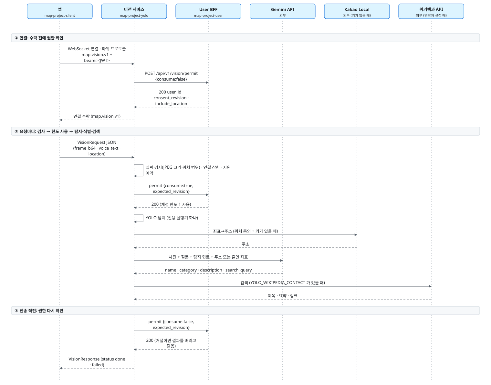

# 구조

## 한눈에

앱이 카메라 사진이나 질문을 WebSocket 으로 보내면, 이 서비스가 사용자 권한과 계정 한도를 User BFF 에 확인한 뒤 사진을 YOLO 로 탐지하고 Gemini 로 식별해 돌려준다. 서비스는 상태를 저장하지 않는다. 계정 한도와 동의 상태는 User BFF 가 갖는다.

<picture>
  <source media="(prefers-color-scheme: dark)" srcset="diagrams/vision-pipeline-dark.svg">
  
</picture>

그림의 각 요소가 어느 코드에 근거하는지는 [diagrams/CLAIMS.md](diagrams/CLAIMS.md) 에 있다.

## 처리 순서

1. **연결**: 하위 프로토콜 `map.vision.v1` 과 `bearer.<JWT>` 를 확인하고, User BFF 허가 API 를 `consume=false` 로 불러 통과해야 연결을 수락한다. 연결 때의 사용자 ID 와 AI 동의 개정 번호를 소켓에 고정한다.
2. **요청 검사**: 메시지 크기·개수, 스키마, 사진(JPEG 형식·디코딩 크기·픽셀 수), 위치 범위를 외부 호출 전에 검사한다. 형식 오류는 계정 한도를 쓰지 않는다.
3. **자원 예약과 한도 사용**: 프로세스 자원을 먼저 예약하고(가득 차면 즉시 거절, 한도 쓰지 않음), 허가 API 를 `consume=true` 로 불러 계정 한도 1을 쓴다. 위치 공유 동의가 없으면 위치를 지운다.
4. **사진 경로**(`voice_triggered=true`)
   - YOLO 탐지: 신뢰도가 가장 높은 객체 하나를 힌트로 쓴다.
   - Gemini 식별: 사진, 질문, 탐지 힌트, 위치(동의했을 때만)를 보내 `{name, category, description, search_query}` JSON 을 받는다. 위치는 Kakao 키가 있으면 역지오코딩한 주소로, 없으면 소수 셋째 자리(약 100m)로 줄인 좌표로 보낸다.
   - 위키백과 검색: `YOLO_WIKIPEDIA_CONTACT` 가 있을 때만 `search_query` 로 검색한다. 실패해도 식별 결과는 살린다.
5. **텍스트 경로**(`voice_triggered=false`)
   - "근처 카페 찾아줘" 처럼 위치 표현과 장소 유형이 함께 있으면 Kakao 키워드 장소 검색 결과만 답한다. Kakao 키가 없거나 결과가 없으면 실패로 답하고, 모델로 장소를 지어내지 않는다.
   - 그 밖의 질문은 질문·이전 맥락·대화 기록을 데이터로 감싸 Gemini 에 보내 한국어 답을 받는다.
6. **전송 직전 재확인**: 결과를 보내기 전에 허가 API 를 `consume=false` 로 다시 부른다. 그사이 로그인이 끊기거나 동의·정책이 바뀌었으면 결과를 버리고 실패로 닫는다.

## 모듈

| 모듈 | 역할 |
|---|---|
| `map_project_yolo/main.py` | FastAPI 앱, 부팅(설정 검사, 허가 클라이언트·추론 실행기·탐지기·그래프 준비), `/health`, `/metrics`, `/ws/vision` 연결 |
| `map_project_yolo/api/ws.py` | WebSocket 처리: 인증, 입력 상한, 허가 확인 세 번, 사진·텍스트 경로, 오류를 고정 문구로 변환 |
| `map_project_yolo/api/permit.py` | User BFF 허가 API 클라이언트. 허용된 거절 사유만 통과, 응답 형식 엄격 검사 |
| `map_project_yolo/vision/runtime.py` | 프로세스 전체 동시 작업 상한과 단일 추론 실행기 |
| `map_project_yolo/vision/frame.py` | base64·JPEG·디코딩 크기 검사 |
| `map_project_yolo/vision/detector.py` | YOLO 가중치 적재와 한 장 추론 |
| `map_project_yolo/graph/vision_graph.py` | LangGraph 그래프: 식별 → 검색 |
| `map_project_yolo/nodes/identify_node.py` | Gemini 사진 식별 |
| `map_project_yolo/nodes/search_node.py` | 위키백과 검색(운영자 연락처가 있을 때만) |
| `map_project_yolo/nodes/kakao_local.py` | Kakao 키워드 장소 검색, 좌표→주소 |
| `map_project_yolo/gemini_client.py` | Gemini 클라이언트(프로세스당 하나) |
| `map_project_yolo/log_redaction.py` | 로그에 실린 좌표 가림 필터 |
| `map_project_yolo/settings.py` | 환경 변수 설정 |
| `map_project_yolo/schemas/vision_schemas.py` | 요청·응답·그래프 상태 스키마와 크기 상한 |

## 외부 의존성

| 대상 | 쓰는 곳 | 없을 때 |
|---|---|---|
| User BFF 허가 API | 모든 연결과 작업 | 부팅은 되지만 모든 연결이 `1013` 으로 닫힌다. 내부 토큰이 비면 부팅하지 않는다 |
| Gemini API(`google-genai`) | 사진 식별, 텍스트 답변 | 키가 비면 부팅하지 않는다 |
| Kakao Local API | 장소 질문, 역지오코딩 | 키가 비면 장소 질문은 실패, 위치는 좌표를 줄여 보낸다 |
| 위키백과 API | 식별 뒤 검색 | `YOLO_WIKIPEDIA_CONTACT` 가 비면 부르지 않는다(검색 결과 빈 배열) |
| YOLO 가중치 `yolo11n.pt` | 탐지 | 이미지는 빌드 때 받아 해시를 확인한 파일을 쓴다. 이미지 밖에서 파일 없이 띄우면, 설치된 ultralytics 가 같은 이름의 공식 자산을 GitHub 릴리스에서 내려받으려 한다(이때는 해시를 확인하지 않는다) |

## 제한시간과 한도

| 설정 | 기본값 | 뜻 |
|---|---|---|
| `YOLO_GEMINI_TIMEOUT_SECONDS` | 25 | Gemini 호출 한 번 |
| `YOLO_JOB_TIMEOUT_SECONDS` | 45 | 작업 하나 전체(탐지·식별·검색). 식별 한도보다 커야 검색 도중 잘리지 않는다 |
| `YOLO_PERMIT_TIMEOUT_SECONDS` | 5 (0 초과 30 이하) | 허가 API 호출 한 번 |
| `YOLO_WS_IDLE_TIMEOUT_SECONDS` | 120 | 메시지 없이 기다리는 시간 |
| `YOLO_WS_MAX_JOBS` | 60 | 연결 하나가 외부를 부르는 처리 횟수 |
| `YOLO_WS_MAX_MESSAGES_PER_CONNECTION` | 240 | 연결 하나가 보낼 수 있는 메시지 수 |
| `YOLO_MAX_CONCURRENT_JOBS` | 2 (1~8) | 프로세스 전체 동시 작업 |
| 위키백과 호출 | 10초, 결과 3개 | 코드 고정값 |
| Kakao 호출 | 5초, 반경 2km, 결과 5개 | 코드 고정값 |
| 메시지·사진 | 4 MiB, 2 MiB·2048×2048 | [contracts.md](contracts.md) |

## 동시성

- 공유 YOLO 모델은 스레드 하나짜리 전용 실행기에서만 돈다. native 추론은 중간에 멈출 수 없어서, 응답 제한시간이 지나도 추론이 끝날 때까지 다음 사진 추론을 받지 않는다(큐에 쌓지 않고 바로 거절).
- 사진 작업은 프로세스 안에서 한 번에 하나, 전체 작업은 `YOLO_MAX_CONCURRENT_JOBS` 개까지다. 자원을 못 잡으면 계정 한도를 쓰기 전에 거절한다.

## 로그와 개인 정보

- 요청 로그와 외부 요청 로그(httpx)에 실린 좌표 값(`lat`·`lng` 계열, Kakao 쿼리의 `x`·`y`)을 로그로 나가는 길목에서 `***` 로 가린다.
- 입력 값, 검증 오류 본문, 외부 서비스 오류 본문은 응답이나 로그로 돌려주지 않는다. 실패 응답은 고정된 한국어 문구다.
- 받은 사진·질문을 저장하지 않는다. 학습용으로 모으지도 않는다.

## 컨테이너 이미지

- 두 단계 빌드다. 빌드 단계에서 CPU 전용 torch 를 먼저 고르고 그 판을 제약으로 고정해 휠을 만든다. 실행 단계는 그 휠만으로 설치한다.
- YOLO 가중치는 공식 릴리스 주소에서 받아 sha256 으로 확인한 뒤 이미지에 넣는다. 그래서 실행할 때 네트워크나 쓰기 권한이 필요 없다.
- 비루트 사용자(uid 10001)로 실행한다. 실행에 필요 없는 perl 을 지우고, setuid·setgid 비트를 없앤다.
- 빌드 마지막에 네트워크를 끈 채 `scripts/verify-headless-runtime.py` 를 돌려, GUI 라이브러리 없는 OpenCV·CPU 전용 torch·합성 JPEG 한 장 추론이 되는지 확인한다.
- `LICENSE` 와 `NOTICE` 를 이미지 작업 경로(`/app`)에 넣는다.

## 한계

- `/health` 는 프로세스가 떠 있는지만 본다. Gemini 나 허가 서비스가 죽어도 `200` 이다.
- native 추론을 강제로 끝내는 기능은 없다. 모델이 멈추면 운영자가 프로세스를 다시 띄워야 한다.
- 텍스트 질문도 사진 인식과 같은 계정 한도를 쓴다.
- 장소 질문 판별은 키워드 규칙(위치 표현 + 장소 유형)이다. 규칙에 없는 표현은 일반 질문으로 처리된다.
